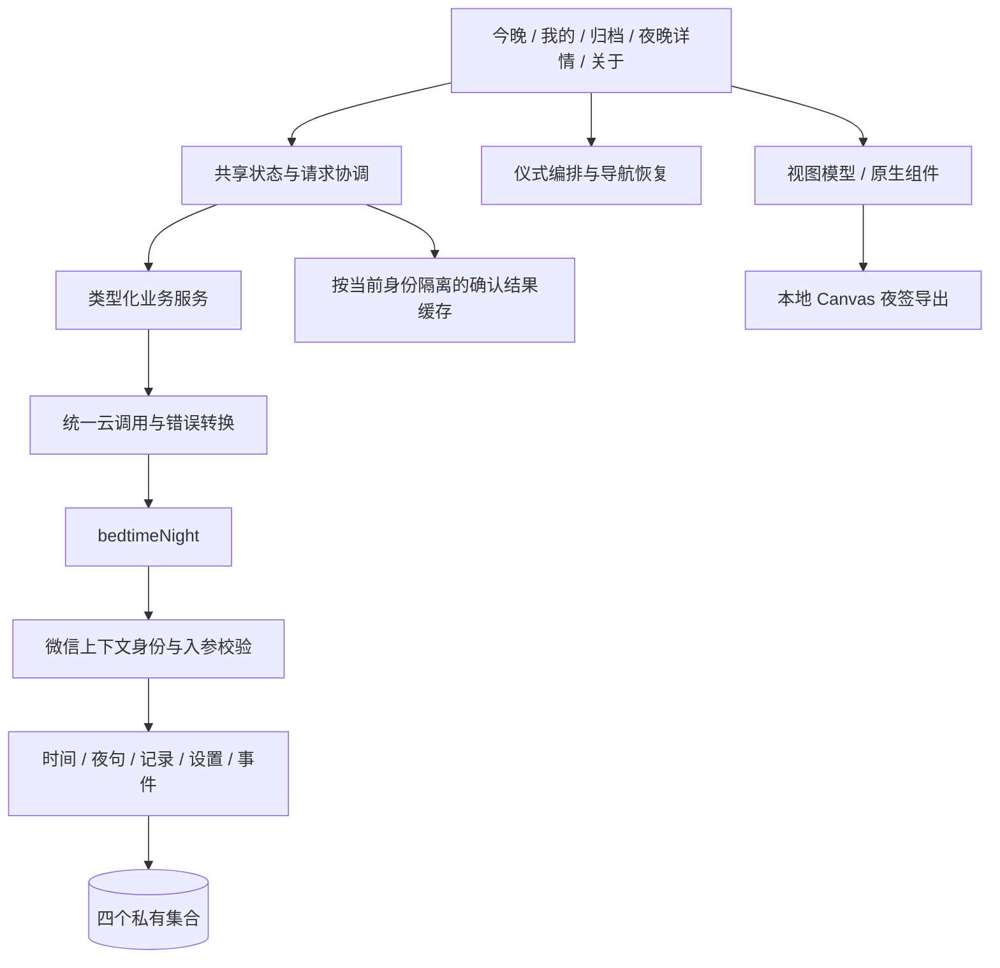
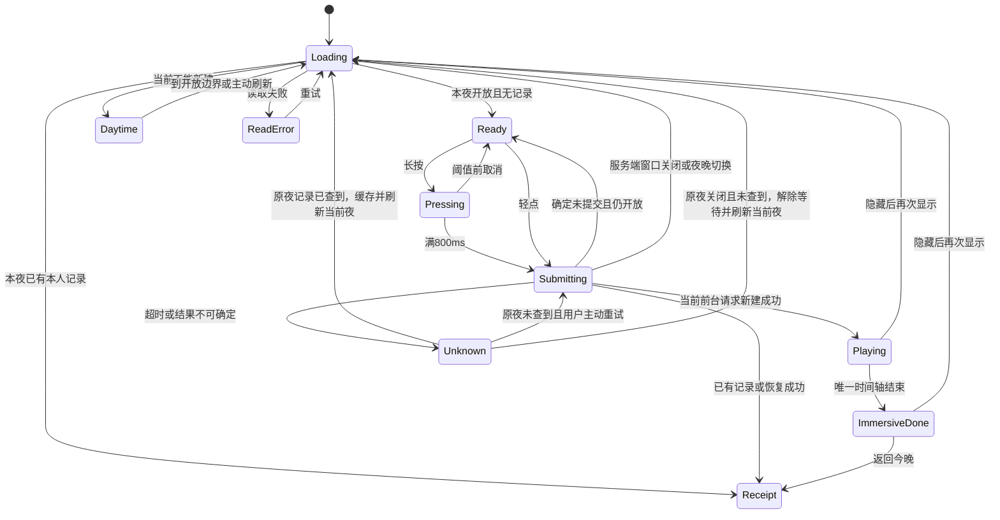

# 今晚关灯 · 产品与施工架构 v1.1

2026-11-07 · 独立完整规格 · 面向后续施工 · 同日修订两次

第一次修订改动七处：新增 1.0 一页体验；开放窗口由 17:00—次日 09:00 改为 **20:00—次日 06:00**；黑屏留白取消初始默认值，改为 M0 三档实测对比；夜签图加入通用小程序码；句子池重写并引入记忆点要求；补充 `n_events` 的文档 ID 与 `closeLight` 非事务读的结论边界；第 16 节说明 M1 的 3/7 不能直接否定完整产品。

第二次修订处理评审提出的两处冲突与三处补齐：限定 1.0 一页体验的效力范围并修正与长按时序冲突的叙述；**删除 `closeLight` 事务外的窗口早退**，统一为「事务内先判记录、确需新建才查窗口」；补齐通用码的生成参数与扫码验收（并更正「必须发布才能生成」这一说法）；三档留白测试补入正向观察项与轮换要求；3/7 的口径改为衡量当前 M1 组合而非孤立动作。同时在 0.1 节新增「设计判断」一类，并把 20:00 的理由降级为判断。

<details>
<summary>展开章节目录</summary>

- [0. 文档效力与阅读方式](#0-文档效力与阅读方式)
- [1. 产品定义与范围](#1-产品定义与范围)
- [2. 页面结构与导航](#2-页面结构与导航)
- [3. 今晚普通页的状态](#3-今晚普通页的状态)
- [4. 唯一的交互时间线](#4-唯一的交互时间线)
- [5. 长按、轻点与取消](#5-长按轻点与取消)
- [6. 后台、恢复与生命周期](#6-后台恢复与生命周期)
- [7. 演示模式](#7-演示模式)
- [8. 我的、回执与私有归档](#8-我的回执与私有归档)
- [9. M1 简单夜签图](#9-m1-简单夜签图)
- [10. 视觉与可读性](#10-视觉与可读性)
- [11. 今晚一句：编辑规则与 30 句候选](#11-今晚一句编辑规则与-30-句候选)
- [12. 客户端与服务端架构](#12-客户端与服务端架构)
- [13. 时间、记录与恢复](#13-时间记录与恢复)
- [14. M1 数据模型与句子冻结](#14-m1-数据模型与句子冻结)
- [15. 云函数、事务与失败恢复](#15-云函数事务与失败恢复)
- [16. 验证、观测与继续投入的依据](#16-验证观测与继续投入的依据)
- [17. 微信平台实现与能力边界](#17-微信平台实现与能力边界)
- [18. 工程范围与阶段验收](#18-工程范围与阶段验收)
- [19. 部署替换、回退与清理](#19-部署替换回退与清理)
- [20. M2 扩展准则](#20-m2-扩展准则)
- [21. 用户可见文案基线](#21-用户可见文案基线)
- [22. 实施验收清单与交付记录](#22-实施验收清单与交付记录)
- [23. 来源与待验收边界](#23-来源与待验收边界)

</details>

## 0. 文档效力与阅读方式

本文定义「今晚关灯」的产品、页面、交互、业务规则、数据契约、工程组织与验收。施工不需要回读此前版本寻找补充条件。此前版本保留为历史材料，发生冲突时，新产品的目标行为以本文为准。

**本文是目标规格，不把实现与全部验收混为一谈。** 2026-11-08 作者放行 M1 并授权完成本地与云端。六个业务动作、归档、夜签图片、偏好和最少观测已实现，业务函数与四集合已部署。实际证据、真机与公开发布边界见 [M1 交付记录](refactor-m1-delivery.md)；[M0 记录](refactor-m0-review.md)和 [M1 第一段](refactor-m1-core.md)保留阶段过程。旧前端与业务规则已清理，不做迁移或兼容层。

没有老用户是本次重建的产品前提，因此不建设旧记录迁移和新旧客户端双写。但是，已有云环境中的测试数据、函数和触发器仍需清点；删除云资源属于发布后的独立操作，不由“重建”二字自动执行。

### 0.1 规格的四种性质

| 性质 | 内容 | 如何改变 |
| --- | --- | --- |
| 必须遵守的业务约束 | 一夜最多一条真实记录、服务端鉴权、未知结果不能说失败、真实句子随记录冻结、无睡眠效果推断 | 改本文和契约测试后再施工 |
| 设计判断 | 窗口起点 20:00、黑屏留白是这个动作的差异点、句子需要记忆点、沉浸态不放分享入口 | 标注为判断、写明理由；有相反证据时推翻，但推翻要替换成另一个判断，不能留空 |
| 体验参数 | 800ms 按压、**800ms 留白**、常规字号、系统无衬线、正常动效，声音首次默认关闭 | 2026-11-08 作者确认并放行 M1；后续变化统一更新参数与验证，不由各模块各改一套 |
| 后续产品假设 | 灯迹是否有用、内容账号是否带来使用、重复使用能否形成习惯 | 有证据再立项；不在 M1 偷加字段、页面或后台系统 |

**关于「设计判断」这一行。** 本文多轮修订的方向是持续弱化断言、增加限定，这对「把没验证的东西说成已验证」是必要的纠正。但它有一个累积副作用：如果连选择的理由也一并删掉，决定就变得不可追溯，三个月后没人记得为什么是 20:00，于是每个已定的事情都会被反复重开，而重开的成本远高于写错一句判断。

所以规则是：**设计判断可以写进文档，只要明确标注它是判断而不是证据，并写出理由。** 要删的是「已验证」的伪装，不是理由本身。

### 0.2 施工入口

- 产品、设计、内容：先读“产品定义与范围”“页面与体验”“视觉与内容”“验证与判断”。
- 前端：继续读“客户端架构”“时间模型”“接口契约”“平台与验收”。
- 后端：重点读“时间模型”“数据模型”“写入与恢复”“接口契约”“部署与交付”。
- 每个实现任务都要说明其所属阶段、改动文件、依赖接口和验收项。不能以页面能打开代替业务闭环，也不能以单元测试代替真机体验。

## 1. 产品定义与范围

### 1.0 一页体验

下面这段叙述里没有一个「不」字，也没有任何约束条款。它是给美术、动效、视频和对外沟通用的唯一情绪基准；后面所有章节描述的是同一件事的机制面。

**它的效力范围要说清楚：这段叙述约束情绪和体验顺序，不覆盖真实成功条件、业务规则和平台边界。** 实现与叙述冲突时，先判断是哪一边错了——如果是叙述把机制写软或写强了，改叙述；如果是实现让情绪不成立了，改实现。两者都不自动优先。

晚上十一点多，你还在刷手机。你知道该睡了，但总想再看一会儿。

你退出当前这个 App，从微信下拉，点开「今晚关灯」。

屏幕上是一栋楼的夜景，几十扇窗模糊地亮着。中间偏左有一扇窗比别的清楚，泛着很淡的冷白光，像有人还醒着。那是你的窗。

下面一行小字：灯还亮着。

你把拇指按在那扇窗上。窗由冷白转成暖黄，像有人把吸顶灯换成了床头灯。暖光慢慢向窗芯收拢。

光收成一点。片刻后，窗灭了。

然后整个页面暗下去，一片黑。手里的屏幕安静下来。

黑着，停了一会儿。

一句话很淡地浮出来：

> 今天就到这里。剩下的，明天再说。

你读完它。此刻把手机扣下，这一晚就结束了。如果你还拿着，屏幕最下面有一行很暗的字：放下手机。

第二天你再打开它，它会告诉你昨晚那扇窗、那句话、你关灯的时间。你可以把那句话存成一张图。

### 1.1 定位

> 给舍不得结束今天的人，一个轻轻关灯的动作。

产品名：**今晚关灯**。对外口号：**今天先到这里**。

服务的是夜里已经想结束手机使用、希望用一个简短动作表达这个决定的人。年龄、职业、是否试过其他工具均为待观察信息，不写成已验证的用户事实。首版面向北京时间的常见夜间使用，不服务全天轮班记录或睡眠监测。

产品提供三件事：一个可感知的结束动作；一句与当晚绑定的短句；一份仅自己可见的历史记录。用户完成动作后可以立即离开，不需要再分享、浏览、设置或维持连续天数。

### 1.2 产品能证明什么

记录表示“这个微信用户在这个夜晚完成过一次关灯操作”。它不表示实际关了房间的灯、已经睡着、睡得更早、停止使用手机，或达到了健康目标。

一栋楼的背景是插画，不是其他用户状态。没有伪造人数、在线头像、跟随熄灯或全国睡眠样本。没有用户也应能完整使用，不把冷启动依赖藏进视觉里。

### 1.3 三个阶段

| 阶段 | 交付范围 | 进入下一阶段的条件 |
| --- | --- | --- |
| **M0：真机体验原型** | 真实微信页面内的一扇窗、按压/轻点、确认模拟、暗屏、句子、退出/返回；静态夜签模板可以并行 | iOS/Android 上交互可理解、导航可恢复、文字可读；确认实际可控的暗屏范围；完成 800/1600/2500 三档留白对比并选定；冻结唯一时间轴 |
| **M1：可自用并可首发的核心产品** | 真实单夜记录与重试恢复、当晚句子、普通回执、私有归档与详情、本地夜签导出、声音/震动/动效设置、隐私说明、最少观测 | 先交付可自用闭环即开始 14 晚记录；首发前再完成归档导出、平台与云端验收 |
| **M2：有信号后的扩展** | 候选为公共灯迹、公开分享页、渠道归因、可视化看板；每项单独决定 | M1 核心动作可用，并出现与该功能有关的需求或数据；另补完整接口与验收后才施工 |

**M1 不含：** 个人关灯目标、`hit/late`、连续/累计成绩、七夜打卡点阵、补签、好友、UGC、排行榜、订阅提醒、公开卡片、公共人数、定时统计任务、商业化。M1 的私有归档只列实际留下记录的夜晚，不展示“缺了哪晚”。

这不是要求先做完所有内容才能自用。M1 的最短闭环是“打开 → 真实提交 → 成功反馈 → 退出 → 重进恢复”，该闭环通过后立刻开始使用，其他 M1 交付继续推进。

### 1.4 首版入口与传播

微信小程序适合承接已经在微信中的收尾需求，但额外打开它仍然有成本。普通回执与“我的”提供添加到我的小程序的操作说明，完成仪式不展示添加提示。

夜签图和内容账号是可验证的传播方式。M0 可以发静态素材并记录曝光与互动，不能用素材收藏量代替仪式有效性。M1 海报不依赖公开页或个性化小程序码，先让一句话本身成立；图片不印个人标识、精确时间或人数，只带一张所有人共用的通用小程序码作为回到产品的路径。


## 2. 页面结构与导航

两个 Tab 分别是「今晚」和「我的」。
今晚页负责普通状态、关灯交互和沉浸完成态；我的页负责私有归档、偏好和关于。
私有归档和归档详情使用普通页面跳转，不新增 Tab。
M1 没有公开页、灯迹页或用户可见运营看板。

| 页面或视图 | 路径 | 主要内容 | 导航方式 |
| --- | --- | --- | --- |
| 今晚普通页 | `pages/night/index` | 夜景、当前动作或最近一张回执 | 显示两个 Tab |
| 沉浸完成态 | 今晚页内部视图 | 暗屏、当夜句子、退出和返回今晚 | 隐藏 Tab，提供明确返回路径 |
| 我的 | `pages/me/index` | 夜签归档、声音、震动、减少动效、添加说明、关于和隐私 | 显示两个 Tab |
| 私有归档 | `pages/archive/index` | 实际有记录的夜晚倒序列表 | 返回我的 |
| 归档详情 | `pages/receipt/index?nightId=YYYYMMDD` | 日期、原句、本人关灯时刻、保存夜签 | 返回归档 |
| 关于与隐私 | `pages/about/index` | 产品说明、北京时间范围、隐私说明、数据删除联系入口、版本 | 返回我的 |

沉浸完成态是今晚页内部的临时视图，不是整个应用的永久落点。
进入沉浸态时显式隐藏原生 Tab；仅用遮罩不能保证覆盖原生导航区域。
完成时间线结束后，主动作是「放下手机」，低强调导航是「返回今晚」。
「放下手机」只尝试退出小程序，不承诺锁屏或阻止用户打开其他应用。
「返回今晚」关闭沉浸态、恢复 Tab，展示本夜普通回执；此后可以点击「我的」访问设置。
本夜普通回执也保留「放下手机」退出入口，仅在用户点击时尝试退出小程序。
正常返回、退出失败后的返回、页面隐藏后恢复及异常恢复路径，都必须正确恢复 Tab。
重进应用直接显示普通回执，不自动重新黑屏，不重播成功声音、震动或仪式。
沉浸态不出现灯迹、添加到我的小程序、声音设置或分享提示。

## 3. 今晚普通页的状态

服务端决定当前夜晚和开放边界；客户端根据返回的时间和记录展示界面。
下面的状态只描述普通页，首次成功的沉浸体验另按时间线执行。

| 条件 | 主区域 | 回执区域 |
| --- | --- | --- |
| 本夜无记录，12:00–20:00 | 「今晚 20:00 可以关灯。」及演示入口 | 有历史时显示最近一张回执 |
| 本夜无记录，20:00–次日 06:00 | 夜景、「灯还亮着。」、长按和轻点入口 | 不在主动作前堆放历史内容 |
| 本夜无记录，06:00–12:00 | 「这一晚已经结束。今晚 20:00 再见。」及演示入口 | 有历史时显示最近一张回执 |
| 本夜已有记录 | 「这一晚已经关灯。」和本夜普通回执 | 不提供再次提交入口 |
| 本夜无记录且无任何历史 | 按当前时段显示主区域 | 不画空白历史格，不显示未完成提示 |
| 无法确认服务端状态 | 明确的加载或重试说明 | 同一已鉴权会话中缓存的本人回执可带离线说明展示 |

普通回执显示明确的夜晚日期、原句和本人关灯时间。
标题优先使用「11 月 7 日的夜晚」，避免中午切换或跨午夜时误称「昨夜」。
跨午夜的个人时间显示为「11 月 8 日 01:12 关灯」，不让用户自行猜日期归属。
本夜已经结束、或进入下一夜，都不重新评价过去的记录。
首次进入开放时段可以直接操作，不强制教程、填写目标、选择心情或开启声音。
首次窗边显示「你的窗」文字锚点；其后仍有清楚的主按钮和文字状态，不仅靠颜色指路。

## 4. 唯一的交互时间线

标准时间线的单位是本机已过去的时长，不把服务端写入时间直接当作动画时钟。
服务端确认时间保留为业务记录；收到本次成功响应后，才建立本次播放的本机起点。
网络等待不计入暗屏和句子时间，不能因为响应慢而跳过用户应当看到的反馈。
以下参数已按作者的 iPhone 体验与 Android 简测反馈冻结为 M1 基线；详细真机验收仍独立记录。后续调整必须更新本表和验收夹具。
进入 M1 后，真实操作与演示共用同一份参数，不各自维护近似的动画。

| 阶段 | 起点与时长 | 画面与反馈 | 操作状态 |
| --- | --- | --- | --- |
| 按压 | `touchstart` 后 0–800ms | 冷白变暖与光收拢并行，进度与按压时长同步 | 未达到阈值可取消 |
| 提交 | 到达 800ms 即提交，不等待松手 | 光停在窗芯；文案「正在确认」 | 禁止重复提交 |
| 等待 | 提交至收到明确结果 | 保留安静、可辨认的等待状态，不提前黑屏 | 8 秒未确认进入结果核对入口 |
| 确认反馈 | 收到本次成功响应，定义为本机 0ms | 窗熄灭；按偏好播放一次轻声和轻震 | 开始沉浸态并隐藏 Tab |
| 暗屏 | 0–400ms | 内容区由夜景过渡到黑色 | 不插入其他任务 |
| 留白 | 400–1200ms，共 800ms | 内容区保持黑色 | 不展示句子或增长提示 |
| 出句 | 留白结束后 400ms | 当夜句子淡入 400ms | 不出现第二轮内容揭晓 |
| 静态完成 | 出句结束 | 原句、「放下手机」、「返回今晚」 | 可立即退出或返回 |

**M1 标准留白为 800ms，标准完成时间线共 1600ms。**

2026-11-08，作者在 iPhone 真机体验后选择 **800ms 留白、正常动效、常规字号、系统无衬线字体**，认为主动开启关灯声时体验更好；声音仍**首次默认关闭，由用户开启**。随后反馈 Android 简单测试也没有问题，并明确要求进入下一阶段开发。这是当前参数选择与开发放行的依据，不等于全部 OLED / LCD、锁屏、音频互斥、大字号或连续睡前验收均已完成。

原型中的“正常确认 250ms”只是模拟响应场景，不是正式版固定延迟或成功条件。真实版本等待服务端确认，超时则核对原夜。减少动效选项保留，仍采用黑色 800ms、零过渡分支。

M0 曾设置 800 / 1600 / 2500ms 三档和六种轮换顺序；原测试方法同时观察卡住疑虑、提前点击、被打断，以及结束感和愿意重复。详细比较记录与连续睡前记录尚未提供，不根据一次简测宣称某一档更有效。M0 记录留档，当前不继续保留实验入口。

800ms 阈值触发后，松手不会取消已经发出的请求，也不会触发第二次提交。
动作的成功终点是确认后进入完成态；黑屏时长由 M0 实测决定，任何具体数字都不是产品信条。
内容区黑色不等于物理屏幕全部关闭，微信胶囊、系统状态栏等保留平台实际行为。
对外演示使用真实录屏或实拍，不通过后期抹除系统区域来夸大暗屏效果。
不调用系统亮度接口；LCD 的背光仍可能可见，原型验收记录这种设备差异。

## 5. 长按、轻点与取消

主按钮文字为「按住关灯」，窗本身也可作为同一个动作入口。
两个入口复用同一提交状态，不允许窗和按钮各自发起独立写入。
「轻点关灯」是独立可点击的完整入口，触控区高度不低于 44px。
轻点直接进入提交与「正在确认」，不要求用户等待一段模拟长按动画。
轻点与长按共用成功后的时间线：标准动效按第 4 节的阶段表执行；开启减少动效时按第 8 节的零过渡分支执行，黑屏停留固定 800ms，不随标准留白的 M0 结论变化。
长按和轻点仅在本地操作和观测方法上区分，真实记录的业务含义一致。

| 情形 | 行为 |
| --- | --- |
| 未满 800ms 松手 | 取消，200ms 恢复初始窗光和文案，不提交 |
| 手指离开控件外接矩形超过 24px | 同上；取消后本次手势不可重新触发 |
| 系统产生 `touchcancel` | 同上 |
| 按压期间页面隐藏 | 取消，清理动画与计时，恢复时不续接按压 |
| 按压期间窗口关闭 | 取消并刷新普通页；服务端仍独立检查提交边界 |
| 提交后重复点击 | 保持正在确认，不额外提交 |
| 请求明确失败且没有记录 | 恢复可操作状态，显示短说明；不播放成功反馈 |
| 超过 8 秒仍无明确结果 | 显示「暂时没确认，查看结果」，查询权威状态 |

结果核对查到记录时，同夜显示普通回执；如果已经进入另一夜，只缓存原夜记录并刷新当前首页，不用旧回执盖住新夜关灯入口。两种情况均不补演长按或成功仪式。
核对确认没有记录且窗口仍开放时，允许用户重新操作；界面不把未知状态说成失败。
原夜窗口已经关闭且未查到记录时，解除本次等待并刷新当前夜状态，不为旧意图补造记录，也不把新夜误判为已结束。
状态未知时不展示一张看似成功的新夜签，也不把演示混入真实历史。

## 6. 后台、恢复与生命周期

把手机翻面不必然使小程序进入后台；实现只依据真实生命周期事件，不据此推断用户行为。
页面隐藏时停止界面计时、按压动画和待播放的声音，不依靠冻结的定时器排队补播。
隐藏期间请求仍可能写入成功；再次显示时先核对记录，而不是假定请求已取消。
用户在提交后离开，响应晚到时可以更新安全缓存，但不得在后台补播声音或震动。
用户在沉浸时间线中离开，返回时直接显示普通回执，不重放剩余阶段。
应用被杀、重新启动或切换 Tab 后回来，均按服务端状态和已确认记录恢复普通页面。
仅当前页面、当前用户、当前夜晚的活跃操作，可以触发一次新的完成时间线。
已有记录、重复请求返回的原记录、历史查询结果都不触发成功声音或震动。

## 7. 演示模式

等待时段和已结束时段提供「看一次关灯」入口，副文案为「演示，不会留下记录」。
演示与真实模式共用按压、取消、暗屏、留白和句子淡入编排。
演示提交点使用本地模拟确认，不调用真实关灯接口，不写云端或本地真实记录。
演示不震动；声音遵守用户声音偏好，默认不响，不擅自开启。
演示固定使用「今天就到这里。剩下的，明天再说。」作为单独标记的示例句，不读取或伪造某夜的真实句子快照。
从进入到退出保持明确的「演示」标识，演示黑色画面也不隐藏这项身份说明。
演示完成主动作是「结束演示」，返回进入前的普通页，不调用退出小程序。
演示不生成夜签，不计入激活、真实关灯或复用指标。
用户中途返回或进入后台时结束演示；返回应用不继续播放。

## 8. 我的、回执与私有归档

我的页只提供：夜签归档、关灯声、震动、减少动效、添加入口说明、关于和隐私。
声音在 iOS 和 Android 默认都关闭；用户主动开启后按已保存偏好执行。
震动默认开启，与声音独立；系统拒绝触感时安静失败，不以声音补偿。
系统静音约束、音频中断和具体平台行为在真机验收，不把本地音量等同于用户设备响度。
不提供「改变系统亮度」或名称相近的设置，也不把暗屏描述为系统亮度变化。
减少动效时关闭呼吸、夜景入场及渐变移动；成功后直接黑色、停留 800ms、直接出现句子和导航。
减少动效不改变长按的 800ms 判定；轻点始终可用。

「添加到我的小程序」是普通回执和我的页中的静态入口。
它不弹出、不在首次成功后主动展开，也不阻止退出。
用户点击后才显示操作说明；以当前微信实际菜单名称和真机截图校对说明。
是否点击说明不能被记作已经完成添加，不尝试用不可观测状态报出添加成功率。

归档按真实有记录的 `nightId` 倒序，首屏 30 条，继续滚动分页。
每条显示夜晚日期和句子首行；详情显示原句与本人记录时间。
不显示空白日期、补签入口、连续计数、完成率或「还差几张」。
长期未使用也直接展示已有记录，不评价缺席，不弹回归任务。
首页只展示当前或最近一张回执；完整历史通过用户主动进入归档查看。

## 9. M1 简单夜签图

夜签图是用户主动保存的句子卡，入口在普通回执和归档详情。
完成态不出现保存、分享或生成海报提示。
首版固定一个模板，不提供换皮、抽签、重新生成句子或集齐奖励。
画面为 1080×1440：夜景、当夜原句、夜晚日期、小字号「今晚关灯」及一个通用小程序码。
不印昵称、头像、用户标识、个人关灯时间、人数或可关联个人的编码。

**通用小程序码是 M1 的必要入口，不是归因工具。** M1 没有公开页、没有聊天卡片，如果夜签图上也没有码，那么内容账号发出去的图和用户存下的图都没有回到产品的路径，第 16 节的激活门槛就只能靠手动拉人达成。

这个码由运营预先生成一张、所有夜签复用同一张，指向 `pages/night/index`，**不携带用户身份或来源参数，所有夜签统一使用固定占位参数 `scene: "0"`**，不区分用户、不记录来源，因此不引入身份泄露、归因系统或逐卡管理。

**生成方式。** 服务端调用 `getUnlimitedQRCode`（`POST https://api.weixin.qq.com/wxa/getwxacodeunlimit`），固定使用正式 AppID、`env_version: "release"`、`page: "pages/night/index"` 和 `scene: "0"`。`scene` 是必填项，这里仅使用统一占位值；它上限 32 个可见字符，`page` 本身不能带参数。显式指定入口路径，不依赖默认首页或页面注册顺序；已发布图片使用的 `pages/night/index` 路由应持续保留。这个接口**返回的是二进制图片流而不是 JSON**，取码时必须按 buffer 读取，否则会得到一张空白图——这是社区里最常见的失败原因。取到的码保存为静态资源随包体发布，不在客户端运行时调用这个接口。

**关于「要不要先发布」，更正本文前一稿的说法。** `check_path` 参数默认为 `true` 时要求 `page` 是已发布小程序的真实页面，但设成 `false` 就可以为未发布的小程序生成码，所以「必须发布后才能生成」**不是平台硬限制**。真正的约束在别处：体验版和开发版的码只有被加入白名单的开发者与体验者能打开，对外素材用它没有意义。因此要拿到一张指向正式版、任何人都能扫进来的码，小程序确实需要先发布。

据此分两步落地：**首发包使用无码模板**；小程序发布后由运营取正式版码，在紧随的版本里替换为带码模板。这个顺序要同时体现在发布顺序与发布验收里。发布前的素材试发同样使用无码版。

两版模板的差别仅在右下角是否有码，其余构图一致，便于内容账号和用户生成的图互相放大。
M1 不包含公开卡片、带参公开页、个性化小程序码或分享归因系统。
保存是本地图片功能；取消或拒绝授权不影响记录、回执或再次使用。
保存失败后保留图片预览和明确说明，不连续弹授权。
平台预览或长按保存能力需真机验证，未验证前不把它写成保证可用的兜底。
历史夜签始终使用当时已确认记录中的句子，不因编辑改文案而悄悄变更。

## 10. 视觉与可读性

夜景采用一栋楼的局部立面，用户的窗是唯一清晰的窗，其余为低对比背景。
静态分层素材完成天空、远楼与近楼；窗光用简单样式和少量图片实现。
不以逐帧 Canvas 绘制夜景；Canvas 仅用于主动生成的静态夜签图。
暖黄仅用在自己的窗和主要动作提示，不用颜色暗示排名或准时程度。

| 元素 | 初始规格 |
| --- | --- |
| 夜空 | 顶部 `#140F1E`，近地平线 `#2E2230` |
| 楼体 | `#0C0A12` |
| 背景窗 | `#3A3340` |
| 自己的窗 | 冷白 `#CFE2F0`，暖黄 `#F0B055` |
| 普通正文 | `#E8E2D6` |
| 沉浸句子 | 黑底 `#B8ADB8`，19px 起，行高 1.7 |
| 次要文字 | `#9A8F9C`，交互文字不依赖低透明度隐藏 |
| 普通按钮 | 16px 起，触控区高度不低于 44px |

可读性优先于「越暗越好」；正文和必要操作文字以对比度至少 4.5:1 为验收目标。
在低亮度、LCD、OLED、320px 宽及系统放大字号条件下分别检查。
句子允许自然换行，通常 1–3 行；窄屏或放大字号时增加行数，不靠缩字维持版式。
当前按作者确认使用系统无衬线字体；缺失时使用平台默认 sans-serif，不分发外部字体包。
不为首版动态拉取大字体包；图片、字体和音效的授权另行留档。
状态与操作都有文字说明，不能只靠窗的色温或一次性标签完成理解。
对无障碍读屏检查按钮名称、焦点次序和完成后的可退出性。

### 10.1 构图基线

普通今晚页采用随可用视口伸缩的一屏布局，不需要上下滑动。夜景位于中上部，在空间充足时约占可用内容高度的 40%—50%；自己的窗位于立面中间偏左，和背景窗保持清晰度差异。状态文案在夜景下方，主按钮与轻点入口位于下部。原生 Tab 已占用底部安全区，普通页不重复叠加安全区高度。
主按钮与窗绑定同一交互；窗的可触摸范围不能小到必须精确点中发光矩形，命中区域至少 44×44px。普通页关闭整页滚动；窄屏、短屏或放大字号时，优先缩减插画高度、间距与次要说明，保留完整状态反馈、演示标识和操作入口，不靠裁切按钮或缩小必要文字来塞进一屏。此规则按 2026-11-08 的首页反馈修订，替代此前允许普通页自然滚动的规定。
沉浸页句子位于可用内容区中部偏上，左右至少 24px 留白；「放下手机」与「返回今晚」位于下部，保持 44px 触控高度并避让底部安全区。句子不因增大字号压住出口。
夜签模板以 1080×1440 为唯一输出画布，上部约 55% 为夜景，下部承载句子和日期；句子使用约 76% 画幅宽度，两侧留白。品牌署名为次要元素。长句先换行再调整留白，不缩成无法阅读的小字。
远景、近景、窗光分别出图；M0 交付包含图层位置、正常与窄屏版式、系统字体回退样张和夜签导出样张。位置比例是原型起点，经过 M0 统一确认后写入对应组件参数，前端不凭多份相互不同的示意图猜布局。首页三层素材保持 720:660 的统一比例，窗光按同一素材坐标定位，触控区域独立保留最小尺寸；夜签图片等比例居中裁切，不能分别拉伸宽高。

## 11. 今晚一句：编辑规则与 30 句候选

句子的职责是给收尾留一句话，不提供睡眠建议，也不要求用户进入新的任务。
每夜所有用户使用该夜已审核的内容快照；个人记录保存当时实际确认的句子。
首发审核后冻结排期，句子更新不回写历史记录。
客户端只缓存已经确认过的真实记录句子，不通过哈希挑句子冒充服务端结果。
演示使用固定示例句；真正缺少当夜内容时按服务端明确的内容方案处理，界面不自行编造。
首发 30 句按固定轮换循环使用，不要求每月强制生产新池；新增内容通过未来生效的版本接续，不能改变已冻结夜句。

编辑标准：短、平、留有余地；40 字以内；不用命令式说教。
不声称「明天一定来得及」「关灯就没人打扰」，不替用户宣布情绪或生活状态。
不把早睡写成人格优点，不用「坚持、战胜、奖励自己」把仪式改成考核。
允许轻微幽默，但不使用梗密集、运势、歌词引用或来源不明的网络句子。

**允许温柔的推测，这是句子有没有人味的分界线。** 「谢谢你今晚没有硬撑」之所以成立，正是因为它做了一个善意的猜测；完全回避推测会让整池句子退化成同一句话的多个变体。禁止的是替用户宣布事实（「你今天一定很累」「你又熬夜了」），允许的是递一句话过去而用户可以不接。

**30 句里必须有 6–8 句是有记忆点的**：有具体意象、有一点锋利，或者有一点幽默。其余保持克制。如果整池句子的音量完全一致，第 16 节的素材试发会拿到假阴性——不是方向不对，是句子太淡没人愿意转。

以下为首发版本 1 文案；2026-11-08 已完成逐句编辑检查与公开检索，过程和有限性见 [内容审阅](night-content-review.md)，不宣称排他原创。标注 ★ 的是承担记忆点职责的句子。

| 序号 | 候选句 | 序号 | 候选句 |
| --- | --- | --- | --- |
| 1 | 今天就到这里。剩下的，明天再说。 | 16 | 明天的清单，明天再打开。 |
| 2 | ★ 今晚不卷，卷被子。 | 17 | 灯关上了，话也可以少一点。 |
| 3 | 手里的光，今晚就看到这里。 | 18 | ★ 谢谢你今晚没有硬撑。 |
| 4 | 不用替今天再补一个结尾。 | 19 | 今晚的最后一件事，是停下来。 |
| 5 | ★ 待办清单翻到背面，也是一张白纸。 | 20 | 先把手空出来，接住这一点安静。 |
| 6 | 今天先收到这里，不急着整理。 | 21 | 今天先装进抽屉，明天再打开。 |
| 7 | ★ 没回完的消息，明天会自己变旧。 | 22 | 让这盏灯替今天说一句：到这里。 |
| 8 | 现在可以暂停，不用写理由。 | 23 | 没有说完的话，可以留在下一页。 |
| 9 | 给今天留个句号，也留点余地。 | 24 | ★ 被子是今晚最小的避难所。 |
| 10 | 灯先关上，答案不用今晚交。 | 25 | 夜里这点空白，就先空着。 |
| 11 | ★ 手指也该下班了。 | 26 | 今天的尾巴，轻轻放下来。 |
| 12 | 先把这一刻，交还给自己。 | 27 | 明天还没开始，今晚可以先结束。 |
| 13 | 今晚就停在这一扇窗前。 | 28 | ★ 夜色不催交卷，这一页可以留白。 |
| 14 | 没收好的念头，可以先放在旁边。 | 29 | 暂停也是一个完整的动作。 |
| 15 | ★ 关灯不是认输，是给明天留电。 | 30 | 留下一句晚安，其他的先放一放。 |

第 1 句同时作为演示句与首发锚点句，**仍然留在池内参与轮换**。因此锚点夜 20261107 展示的真实句与演示句相同，此后每 30 夜重合一次；演示在任何时候都带明确标识，两者不会被混淆。★ 共 8 句，在 30 夜的轮换里大致均匀分布，不连续出现，也不集中在某一旬。


## 12. 客户端与服务端架构

### 12.1 模块边界

保持现有技术栈：原生 TypeScript + WXML + WXSS，CloudBase 云函数使用 Node.js / CommonJS。前端不引入框架或运行时 npm 依赖。页面负责生命周期与交互；视图模型负责状态到文案；共享状态负责服务端快照、缓存与并发；组件负责局部呈现；服务端决定身份、夜晚、是否允许新建和已保存内容。



没有客户端直连数据库，没有通用任意集合代理。Canvas 不参与逐帧仪式动画；仪式使用 WXML/WXSS 和少量状态切换，导出使用一次性 Canvas 绘制。

### 12.2 目标文件结构

以下为 M1 的目标结构，文件名可以按模块内职责继续细分，公开业务名称与边界不随意改变。

```text
miniprogram/
  app.ts / app.json / app.wxss
  pages/
    night/         index.* / view-model.ts / ceremony.ts
    me/            index.* / view-model.ts
    archive/       index.*
    night-detail/  index.*
    about/         index.*
  components/
    window-scene/  index.*
    hold-button/   index.*
    night-mask/    index.*
    night-receipt/ index.*
  state/
    app-data.ts                 # 注入微信平台与真实服务，导出共享实例
    create-night-store.ts       # 可测试的快照、刷新、确认与身份隔离
  services/
    cloud.ts                    # 云初始化、统一响应、传输异常
    night.ts                    # getState / closeLight / getNight / getArchive
    preferences.ts              # setPrefs
    telemetry.ts                # track，永不阻塞业务
  types/
    night.ts / contracts.ts
  utils/
    night-time.ts               # 前端展示用时间规则
    ceremony-clock.ts           # 本机播放经过时间与异常时钟检测
    poster.ts                   # 1080 × 1440 本地绘制
    storage.ts                  # 新版本命名空间与账户隔离
  assets/
    scene/ / tabbar/ / audio/click.mp3
cloudfunctions/
  bedtimeNight/
    index.js / package.json
  common/
    cloud.js / response.js / errors.js
    night-time.js / night-records.js / night-phrases.js
    night-users.js / night-events.js / phrase-catalog-v1.json
  database-indexes.json
  database-rules.json
tests/
  fixtures/night-time-cases.json
  night-time.test.cjs
  night-store.test.cjs
  night-ceremony.test.cjs
  night-backend.test.cjs
  night-archive.test.cjs
  night-poster.test.cjs
  # 保留仍适用的环境、云调用、构建测试
scripts/
  build.mjs / test.mjs / cloud-env.cjs
  night-report.mjs               # 管理端离线只读汇总，不部署为云接口
  night-maintenance.mjs          # 管理端维护：预演清单与授权执行分离
```

`index.*` 指 TypeScript、WXML、WXSS、JSON 四件套。不直接修改 `dist/`。新云函数的 `package.json` 声明当前 SDK 和 `common` 依赖，沿用工作区锁文件与部署打包方式，不复制历史 `node_modules/`。

`night-time.ts` 与 `night-time.js` 各自实现纯函数，使用同一张 JSON 场景表测试；不为共享几行规则引入前端无法打包的 npm 库。后端句子目录是实际发布源；前端仅携带演示句与已经收到的记录快照。

### 12.3 业务快照与页面状态分开

共享 store 保存当前身份、服务端时间样本、本夜规则、本人记录、最近记录、偏好、加载和错误状态。分页归档独立维护游标，不要求首页先加载全部历史。

页面 `data` 只放可序列化的展示字段。订阅句柄、音频对象、Canvas 节点、定时器、手势原点、请求序号和播放时钟均留在逻辑层。页面卸载取消订阅，隐藏取消手势和播放调度。

首页普通业务状态由服务端快照决定：加载、可关灯、已记录、日间等待、状态读取失败。`pressing`、`submitting`、`unknown`、`playing` 属于当前交互，不持久化成“今晚已经成功”。仪式遮罩不是新的路由或业务记录。



图中 `Unknown` 允许离开。原夜无记录时能否新提交，仍由服务端检查；“查询暂未找到”不保证先前请求未来不会写入，重复提交始终依靠同夜唯一性归并。

### 12.4 并发、生命周期与缓存

- 同一页面只保留一个提交意图，记录其 `nightId` 和本地请求序号。禁用重复点击是体验保护，不是幂等实现。
- 每次身份变更、页面重新显示、夜晚切换都递增上下文版本。返回结果可以更新其所属夜晚的确认缓存，但只有上下文、身份、夜晚及当前交互均匹配时才改变当前视图。
- 所有成功播放必须同时满足：本次调用实际新建、仍在原交互的前台、未超时进入未知态、未被更新状态替代。其余成功显示普通回执，不再音效、震动或黑屏。
- `onHide` 不取消已经到达服务端的事务。它只停止本地手势、计时与未开始的反馈，并使本次交互失去自动播放资格。`onShow` 先恢复普通导航，再刷新状态；不补播离开期间的任何一拍。
- 状态刷新可以合并相同的在途读取。提交成功后使首页和归档首屏缓存失效，再合并确认记录；旧刷新结果不得把刚确认的记录清空。
- 每次从后台或其他页面回到今晚页都重新读取服务端状态。同一前台显示周期内复用快照，不轮询数据库；接近 06:00、12:00、20:00 时在本地触发一次刷新。长时间停留导致时钟样本过期时，提交前刷新规则。
- 所有同会话内存私有缓存按 `userId` 隔离，本地恢复标记按 `v11 + userId` 隔离。冷启动尚未确认微信身份时不显示上个账户的历史，仅允许重试；同一会话已确认身份后，可以查看该身份的已确认缓存并标注未刷新。
- 不自动将离线点击排队为之后的真实记录。没有网络时可以演示；恢复网络不补签、不把旧意图写成另一夜。

### 12.5 模块施工边界

| 模块 | 输入 | 输出 | 不承担的职责 |
| --- | --- | --- | --- |
| `hold-button` | enabled、threshold、touch 事件 | 开始/取消/达到阈值、method | 不写云、不决定窗口、不播放成功音 |
| `window-scene` | 窗状态、progress、reduceMotion | 插画与光线 | 不代表他人状态、不读取用户信息 |
| `ceremony` | 当前提交结果、偏好、播放时基 | 遮罩/句子阶段、结束事件 | 不以动画倒推是否已写入 |
| `view-model` | 快照、交互状态、校准时间 | 文案、可见区块、按钮状态 | 不发请求、不访问数据库 |
| `store` | 用户意图、服务返回、生命周期上下文 | 当前快照与订阅通知 | 不保存 WXML 节点、不自行伪造成功 |
| `poster` | 一条确认记录与本地素材 | 临时图片文件 | 不新增关灯、不创建公开身份链接 |
| `bedtimeNight` | 经过校验的 action 与字段 | 权威业务结果或确定错误 | 不信任传入 uid/状态，不提供任意查询 |


## 13. 时间、记录与恢复

### 13.1 M1 的唯一时间规则

所有业务时间使用北京时间 UTC+8；界面明示「开放时间 20:00—次日 06:00（北京时间）」。
M1 不设置个人目标，不标记准时或迟到，不推断入睡，也不计算连续天数。
一次关灯表达「我决定今晚先到这里」，记录的是动作，不是睡眠结果。

窗口起点定在 20:00 是一个**设计判断，不是已验证结论**：「关灯」的语义依附于夜晚，把窗口起点和这个意思对齐，比让它从下午就开放更合理。首版聚焦晚间收尾，因此暂定 20:00—次日 06:00。这个判断可能是错的，窗口长度与起点属于可在 M0 后调整一次的参数，调整后同步更新本表、文案基线与测试夹具。

| 项 | 唯一定义 |
| --- | --- |
| 公共夜晚 | D 日 12:00 至 D+1 日 12:00，左闭右开 |
| `nightId` | 公共夜晚起始日 D，字符串 `YYYYMMDD` |
| 开放窗口 | D 日 20:00 至 D+1 日 06:00，左闭右开 |
| `before` | D 日 12:00—20:00 |
| `open` | D 日 20:00—D+1 日 06:00 |
| `closed` | D+1 日 06:00—12:00 |
| 单夜次数 | 每个用户、每个 `nightId` 最多一条持久记录 |

服务端决定是否允许新建；前端的时间比较只影响展示，不构成授权。
日期运算先进行 UTC+8 偏移，再使用 UTC 日期方法；禁止依赖运行机器的本地时区。
`nightId` 由 `dateKey(beijingNow - 12h)` 得到，跨月、跨年由日历函数处理。
开放窗口完整落在同一个 `nightId` 内（20:00 晚于当夜起点 12:00，次日 06:00 早于当夜终点 12:00），因此不存在跨夜窗口，这是选择该区间的另一个理由。
`windowOpenAt`、`windowCloseAt`、`nextOpenAt` 均为毫秒时间戳。
`nextOpenAt` 指从当前时刻往后最近一次开放起点；当前已开放时，它指下一夜的 20:00。

| 北京时间 | `nightId` | `phase` | 新建关灯 |
| --- | --- | --- | --- |
| 11-07 12:00:00 | 20261107 | before | 否 |
| 11-07 19:59:59 | 20261107 | before | 否 |
| 11-07 20:00:00 | 20261107 | open | 是 |
| 11-08 00:00:00 | 20261107 | open | 是 |
| 11-08 05:59:59 | 20261107 | open | 是 |
| 11-08 06:00:00 | 20261107 | closed | 否 |
| 11-08 11:59:59 | 20261107 | closed | 否 |
| 11-08 12:00:00 | 20261108 | before | 否 |

上述表格由前后端共用测试夹具；另外覆盖月末、年末及闰年。
窗口外允许看回执、归档和演示；演示始终不调用 `closeLight`。

### 13.2 业务时间与播放时间分开

`confirmedAt` 是服务端在成功事务中校验并接受动作时的时间，随记录永久保存。
它不代表客户端刚收到响应的时刻，也不保证等于数据库物理提交的那一毫秒。
首次播放的 `ceremonyStartedAt` 仅保存在客户端逻辑层，从当前有效请求确认 `created: true` 后开始。
动画不得用 `Date.now() - confirmedAt` 推进；否则网络慢会吞掉黑屏时间，设备时钟偏差会直接跳拍。
具体画面时长以交互章节的唯一时间轴为准，本章不另定义一套动效时长。
播放时钟通过可注入的 `now()` 适配器读取，默认使用 `Date.now()`，测试中注入可控时钟。
不假设微信性能对象提供 `now()`；若本机时间出现负向或明显异常跳变，直接结束动画并回到普通回执。
按相对经过时间计算当前画面，禁止用一串延迟回调补播已错过的画面。

只有页面仍可见、仍处于同一提交代际、且响应 `created: true`，才播放一次完整确认反馈。
`created: false` 表示已存在记录，直接转普通回执；不重新播放声音、震动或黑屏。
请求过程中退后台，或者仪式中退后台，均取消后续声音、震动及画面推进。
重新显示后查询记录并展示普通回执，不补播，不再次进入沉浸状态。
在沉浸状态主动点「返回今晚」也执行同样的结束操作，并恢复普通首页及 Tab。

### 13.3 时钟校准只服务展示

每个成功响应携带返回时的 `serverNow`；客户端同时记下本次接收时刻 `receivedAt`。
前台显示所用估计时间为 `serverNow + (deviceNow - receivedAt)`，不直接信任设备绝对日期。
这仍包含网络传输误差，所以临近窗口边界应刷新，实际提交仍由服务端裁决。
若设备时间跳变、页面重新显示、网络恢复或本地估计跨越边界，立即废弃旧估计并刷新。
校准不能用于离线证明某次动作在窗口内，也不能替代 `closeLight` 内的校验。

## 14. M1 数据模型与句子冻结

M1 只新建 `n_users`、`n_nights`、`n_phrases`、`n_events` 四个集合。
灯迹、公开卡片、来源归因、全量看板与定时统计任务均不属于 M1。
所有集合都禁止客户端直接读取和写入；一律通过鉴权后的云函数访问。
`uid` 是服务端取得的微信 OPENID，只作为私有归属字段；仅在私有 `getState` 中以 `userId` 返回，用于隔离本地缓存。
`userId` 不展示、不进入导出图片，也不接受客户端回传它来证明身份；其它记录响应不携带归属字段。

### 14.1 `n_users/{uid}`

```text
{
  uid,
  prefs: { sound: false, haptics: true, reduceMotion: false },
  firstNightId: null,                 // 第一条成功记录所属夜晚
  lastNightId: null,                  // 最新成功记录所属夜晚
  eventBudget: { nightId: null, accepted: 0 },
  createdAt, updatedAt
}
```

声音在 iOS 和 Android 均默认关闭；用户主动开启才播放。
不提供 `dimScreen` 开关；减少动效的表现由交互章节统一定义。
`firstNightId`、`lastNightId` 只能和新增关灯记录在同一事务里更新。
不存累计天数、连续天数、目标时间、`hit/late` 或睡眠时长。
用户首次调用 `getState` 时幂等建档；`closeLight` 也能在自己的事务中处理用户尚未建档的情况。
建档重试不得重置已有偏好或摘要；`setPrefs` 只更新指定偏好字段。

### 14.2 `n_nights/{uid}_{nightId}`

```text
{
  _id: `${uid}_${nightId}`,
  uid, nightId,
  confirmedAt,
  method: 'hold' | 'tap',
  phraseId, phraseText, phraseVersion, poolVersion,
  ruleVersion: 1
}
```

文档 ID 提供单夜唯一性；事务保证记录与用户摘要一致。
记录成功后不可由客户端修改或删除；重复请求返回已存记录，不覆盖时间、方式或句子。
`method` 只用于理解入口使用情况，不改变成功资格。
对本人返回的记录投影为 `nightId, confirmedAt, method, phraseId, phraseText, phraseVersion`。
没有身份公开功能，私有回执和归档接口只读取当前 OPENID 的记录。

### 14.3 `n_phrases/{nightId}`

```text
{
  nightId,
  phraseId, text, phraseVersion,
  poolVersion: 1,
  source: 'rotation',
  frozenAt
}
```

首发 30 句在代码中维护稳定 ID 与固定顺序；上线前逐句审核，发布池记为版本 1。
以 `20261107` 为轮换锚点；索引为该夜距锚点的自然日差对 30 取非负余数。
同一句每 30 夜轮到一次，相邻夜不重复；不使用随机数或日期哈希抽样。
首次真实关灯事务读取该夜发布稿；不存在时按上述规则创建，已存在则使用原稿。
同一夜所有新记录读取同一份被冻结的发布稿；句子同时复制进私人记录。
并发创建由事务冲突重试解决，不能让两个请求分别提交各自的候选句子。
客户端不在云端异常时换成另一句「兜底晚安」冒充真实结果。
真实成功后的回执、私有详情和夜签导出，永远读取该记录中的句子快照。
演示句固定为第一句，必须明确标注演示，不能混入历史。

M1 不提供在线编辑、换一句或撤回发布稿的操作入口。
发布后不得改写已冻结的 `n_phrases` 或已有 `n_nights`。
后续调整句池时，在代码中新增带 `effectiveNightId` 的版本段，只能从尚未开始的未来夜晚生效。
版本段按 `nightId` 选择，旧版本继续保留供复现，不用新池重新计算历史。更新池之前校验生效日前后排期，同一 phraseId 或相同正文在任意连续 30 夜中最多出现一次。
若出现必须紧急停止展示的内容，暂停相关展示并发布明确的单独修复；不得静默替换历史记录。

### 14.4 `n_events/{uid}_{eventId}`

```text
{
  _id: `${uid}_${eventId}`,            // 唯一性由文档 ID 保证，duplicateIds 依赖它
  uid, eventId,
  name,
  props,                             // 下表限定的枚举或布尔值
  receivedNightId,                    // 服务端按收到时刻计算
  receivedDateKey                     // 北京日历日，仅到日，不存个人秒级时间
}
```

客户端每个事件生成 32 位十六进制随机 `eventId`，同一事件重试沿用该 ID。
服务端忽略客户端身份和时间，事件不带句子、动作精确时间、昵称、分享对象或自由文本。

| 事件 | 允许属性 |
| --- | --- |
| `night_view` | `phase: before/open/closed`，`hasRecord: boolean` |
| `ceremony_start` | `method: hold/tap` |
| `ceremony_done_view` | 无 |
| `exit_tap` | 无 |
| `receipt_view` | `source: home/archive` |
| `card_export_result` | `stage: render/save`，`ok: boolean`，`code: OK/RENDER_FAILED/SAVE_DENIED/SAVE_FAILED` |

同一次保存操作可先产生 render 结果、再产生 save 结果；用户在预览后取消保存时只记录已发生的 render 结果。
新增关灯人数与回访按 `n_nights` 统计，首次记录按用户摘要核验，不依赖客户端成功埋点。
埋点只做辅助观察；页面隐藏、退出或失败可能造成丢失，未收到事件不等于行为未发生。
原始事件在分析中仅使用最近 30 天；管理员每周执行带日期边界和预演清单的维护脚本，删除超过 30 天的数据，实际存储上限不超过 37 天。维护须有执行记录；M1 不增加定时云函数。
私人记录和偏好默认长期保留；应用内隐私说明给出数据删除申请入口，由管理员按本人身份核对处理。
删除用户数据时同时处理其用户文档、私人记录和事件，不删除公共夜晚句子稿。

### 14.5 索引与容量边界

| 集合 | 索引 | 用途 |
| --- | --- | --- |
| `n_nights` | `uid ASC + nightId DESC` | 本人历史分页 |
| `n_nights` | `nightId ASC` | 小规模后台核对与后续只读分析 |
| `n_events` | `receivedDateKey ASC` | 按日期清理与人工汇总 |

其余单条读取使用文档 ID；首版不增加为未来功能准备的索引。
云函数返回列表时使用字段投影；不得将内部用户文档或事件整包返回客户端。
生产前以实际云环境核对查询索引、事务冲突重试行为和费用，不以请求次数代替计费读量。

## 15. 云函数、事务与失败恢复

### 15.1 唯一业务函数与响应格式

函数为 `bedtimeNight`，入参沿用现仓库 `{ action, ...fields }`，不再套一层 `payload`。
成功返回 `{ code: 'OK', data }`；失败返回 `{ code, message, data? }`。
所有成功的 `data` 都包含 `serverNow`；窗口类错误的 `data` 可附 `nightId, phase, nextOpenAt, serverNow`。
现有 `common/response` 和 `services/cloud.ts` 保留职责，按需补充结构化错误数据，不另造网络框架。
身份只取 `cloud.getWXContext().OPENID`；缺失则 `UNAUTHORIZED`；不使用客户端身份字段。
未知 action、额外业务字段（包括客户端传入的 uid）、非法类型或超长请求均返回 `INVALID_ARG`。微信平台实测会附加 userInfo / tcbContext；允许这两个传输保留字段，但不从中确认身份。

| action | 业务入参 | 成功结果中的业务字段 |
| --- | --- | --- |
| `getState` | 无 | `userId, nightId, phase, windowOpenAt, windowCloseAt, nextOpenAt, record, lastRecord, prefs, firstNightId, lastNightId` |
| `closeLight` | `clientNightId, method` | `record, created, isFirstEver` |
| `getNight` | `nightId` | `record`，不存在为 `null` |
| `getArchive` | `cursor? , limit?` | `items, nextCursor` |
| `setPrefs` | `prefs`，允许部分字段 | `prefs`，返回合并后的完整偏好 |
| `track` | `events` | `acceptedIds, duplicateIds` |

`record` 与 `lastRecord` 没有数据时为 `null`；如果本夜就是最后一次，二者内容相同。
`getState` 只读取用户、本夜记录和必要的最近记录；最近记录由 `lastNightId` 定位，不扫描全量历史。
`getNight` 可查询本人的任意合法历史夜晚，是超时恢复与归档详情的共同接口。
`getArchive` 默认 30 条、最大 30 条；`cursor` 为上一页最后一个合法 `nightId`。
查询固定为 `uid == 当前用户 && nightId < cursor`，按 `nightId DESC`，多取一条判断是否还有下一页。
`items` 使用私人记录投影；没有后续页时 `nextCursor: null`，不得使用偏移分页。
`nightId` 必须是有效公历日期，不能仅检查八位数字；`getNight` 查询未来夜晚返回 `INVALID_ARG`。`closeLight` 的合法但非当前夜晚输入，按已有记录优先、否则 `NIGHT_CHANGED` 处理。
`setPrefs` 只接受 `sound/haptics/reduceMotion` 中一个或多个布尔值；空更新、其它键、非布尔值均拒绝。

### 15.2 `closeLight` 的唯一写入流程

1. 校验 `clientNightId` 和 `method`，由 OPENID 构造本人本夜文档 ID。
2. **先做一次非事务读**，查请求夜晚的已有记录。读到记录时短路返回 `created: false` 和对应的 `isFirstEver`，即使窗口已关或已跨到下一夜。
3. **读不到一律进入事务，不在事务外做任何时间或窗口判定。** 这是一次非事务读，结论只在"读到了"这个方向上可靠；在事务外提前返回 `NIGHT_CHANGED` 或 `WINDOW_NOT_OPEN`，会把一个其实已经写入成功的请求报成失败。
4. 进入事务，按 ID 再读本人用户、请求夜晚记录及该夜发布稿。
5. **事务内先判断记录是否已存在，存在就直接返回 `created: false`，不再检查窗口**，也不再次写记录、用户摘要或句子稿。
6. 只有确实需要新建时才取服务端时间校验：请求夜晚不同返回 `NIGHT_CHANGED`，未开放返回 `WINDOW_NOT_OPEN`。事务每次重试都重新取时间、重新校验。
7. 缺用户则以默认偏好建档；缺发布稿则按固定轮换生成并冻结。
8. 写入唯一的 `n_nights`，`confirmedAt` 使用本次事务通过校验的时间。
9. 同一事务中，仅在原摘要为空时设置 `firstNightId`，并将 `lastNightId` 更新为新记录夜晚。
10. 提交成功才返回 `created: true`；`isFirstEver` 为该记录夜晚是否等于用户的 `firstNightId`。

**第 3 到第 6 步的顺序是一个正确性要求，不是风格。** 一个真实会发生的竞态是：重试请求的非事务读在 05:59:59 返回空，另一个在途请求在 06:00:00 提交成功，此时若在事务外检查窗口就会返回「窗口已关」——而用户其实已经有记录了。这违反本文「未知结果不能说失败」的基本约束。代价是窗口外的请求也要走一次事务，但那是罕见路径，用它换正确性值得。

事务回调必须能安全重试；回调内不播放声音、不发送消息、不请求外部服务、不写埋点。
一次事务失败不得留下孤立记录或提前推进的摘要；多设备同时提交只能有一个 `created: true`。
不要按笼统的数据库错误码猜测重复写入成功；可在异常后定向读取记录核对，再返回真实结果。异常恢复查到记录统一返回 `created: false`，因为不能证明这次调用独立完成了创建，客户端不得据此播放仪式。
若无法确认是否提交，返回 `INTERNAL`，客户端按「结果未知」处理，而不是提示肯定失败。
`setPrefs` 使用只修改指定字段的事务或字段更新，不能把旧用户对象整份覆盖回去。同一身份的客户端保存队列只允许一个在途请求，等待期间合并最新偏好修改，上一请求结束后再发送；不能同时发送“开”和“关”并寄希望于返回顺序。保存超过 8 秒显示尚未确认、可先离开的说明，仍保留原在途请求与串行队列；不得用超时释放队列让下一次写入抢跑。最终保存失败时提示未保存并刷新云端状态；这次自动回读保留失败说明。后续成功刷新（包括重新进入页面或点击「重新读取设置」）确认服务端状态后清除说明，不自动重试先前失败的修改。不同设备对同一字段以最后提交的值为准，不覆盖彼此未修改的字段。

### 15.3 输入限额与埋点边界

单次业务请求的 JSON 大小不超过 16 KiB；超过则 `INVALID_ARG`。
`track` 每批 1—10 个事件，每个 `props` 序列化后不超过 256 字节，且严格匹配事件白名单。
同一用户每个服务端夜晚最多接收 100 个不同事件，由用户文档的 `eventBudget` 在事务内计数。
同批内重复 ID 先去重；已存事件列入 `duplicateIds`，不再次占额度或覆盖内容。
整批校验失败或新增事件超出额度时整批拒绝，不做难以解释的部分落库；超额返回 `RATE_LIMITED`。
预算检查、事件写入及计数推进同事务提交；事件失败不回滚已经完成的关灯业务。
客户端队列最多 20 条，前台每 3 秒或累计 5 条尝试发送一批；隐藏时只做一次尽力发送。
事件只在本次会话通过 `getState` 确认身份后采集和发送；恢复到前台尚未完成身份刷新时暂停发送。队列绑定 `userId`，身份改变即丢弃旧队列；旧批响应只能清理对应身份与批次的事件。
`ceremony_start` 只在真实提交被发起时产生；`ceremony_done_view` 只在该次真实成功的静态完成态首次显示时产生，按标准或减少动效时间线触发。演示不产生这两个事件，也不产生真实关灯或海报结果事件。
成功按返回 ID 清队列；普通失败允许仍在前台时重试一次，之后丢弃；超额直接丢弃本批。
不为埋点持久化后台重试任务，不阻塞页面退出，也不把这套限额宣传成完整防攻击机制。
所有动作还受云平台并发与预算告警约束；客户端连续点击合并请求，仅是体验保护。

### 15.4 八秒未知态与代际保护

提交时保存 `requestNightId` 和本次请求代际，按钮禁用；8 秒未得到确定结果，转「暂时没确认」。
超时不会取消云端事务，也不意味着写入失败；不能立即换一个请求夜晚重新提交。
提供「查看结果」按钮，定向调用 `getNight({ nightId: requestNightId })`，不能只查新的当前夜晚。
查到记录后同夜显示普通回执；已经跨到另一夜则缓存原夜结果、解除等待并刷新当前首页，不补播、不跳回旧夜。查不到只说明此刻未读到，不能证明原请求永远不会成功。
若原夜仍开放，可明确提供「重试关灯」；沿用原 `clientNightId`，服务端幂等收敛到同一条记录。
若窗口已关或跨夜，只允许再次查询原夜结果并返回普通首页，不补记一条离线记录。
用户随时可点「返回今晚」继续使用；未决标记不锁住下一夜，下一次真实提交可替换它，较早的迟到记录仍由普通回执和归档恢复。
将尚未确认的 `requestNightId` 保存为本地恢复标记，以已确认的 `userId` 隔离存储键。
冷启动先在线调用 `getState` 确认身份，再读取该用户的恢复标记并定向查询；查到记录后清除。成功查空且查询返回的服务端时间证明原夜已关窗或已跨夜时，也清除恢复标记并返回普通页；查询失败不清除。
标记内容不含句子或精确动作时间，也不授权写入；所有查询仍按当前 OPENID 取本人记录。原夜关窗后成功查空时结束本次等待，不在重进时反复要求确认；迟到的真实记录仍由普通回执和归档恢复，新夜允许新的主动关灯。
原请求晚到时，只能更新当前会话中同夜数据；已隐藏、跨夜或代际已变时不触发动画与跳页。
任何异步回调更新页面前，都检查页面可见性、身份代际、提交代际和请求夜晚；卸载后不再更新页面。

### 15.5 缓存与错误枚举

M1 不持久缓存完整私人历史；内存记录、内存偏好和恢复标记都按 `userId` 隔离。
冷启动在线确认身份前，不展示旧私人缓存；身份确认后的同一会话离线时，可以查看该用户已确认的内存记录。
若 `getState.userId` 改变，立即清空当前页面的私人数据、递增身份代际并切换缓存作用域。
同一次 `onShow` 的并发 `getState` 合并为一个请求；每次重新显示都刷新，不用跨夜才失效的长缓存。
关灯成功后立即用返回记录更新内存；改偏好成功后同步当前会话，再在下次显示时核对服务端。
启动采用安全默认偏好，在线确认身份后以服务端结果为准；不再写入没有读取路径的本地偏好副本，不可用旧响应覆盖更新后的偏好。
归档页面返回列表时可复用当前内存页，新增记录后清空列表游标并从第一页刷新。

| 错误码 | 语义与页面处理 |
| --- | --- |
| `UNAUTHORIZED` | 当前调用无微信身份；提示重新打开，禁止真实提交 |
| `INVALID_ARG` | 参数非法；停止盲目重试，记录开发日志 |
| `NIGHT_CHANGED` | 仅新建请求所属夜晚过期；刷新状态，不自动替用户提交新夜 |
| `WINDOW_NOT_OPEN` | 当前不在开放窗口；显示服务端提供的下一次开放时间 |
| `RATE_LIMITED` | 事件预算耗尽；静默丢弃辅助埋点，不影响关灯与回执 |
| `INTERNAL` | 云端未给出可确认结果；写请求进入未知态，读请求提供重试 |
| 客户端 `NETWORK/TIMEOUT` | 网络失败或八秒超时；同样不能据此认定关灯未写入 |

M2 若加入灯迹或公开卡片，应另建只返回脱敏投影的接口与集合，不扩散私人记录响应字段。
M1 不预建 M2 集合、不发布统计触发器，也不让尚未实现的入口出现在页面或接口清单中。

## 16. 验证、观测与继续投入的依据

M0 先验证：用户是否知道按哪里、是否理解等待、是否辨认成功、是否能自然退出，以及黑屏留白多长才既像停顿又不像卡死。
记录真机操作中出现的犹豫、误触、读不清和等待感，不把作者觉得好看当作完成证明。
黑屏留白按第 4 节做 800/1600/2500 三档轮换对比，正负两组问题都要记录，选出候选后在真实睡前环境连续用几晚再冻结。
其余初始参数没有必须守住的神圣值；按真实设备结果统一调定后再冻结 M1 规格。
素材试发回答句子和画面是否引起兴趣，不回答用户是否需要每天使用小程序。
素材数据同时记录曝光与互动；曝光不足或样本太小时标记「没有足够信号」，不强行排序。

M1 的 14 晚自用从最早可用版本开始，每晚只记三件事：何时想起、动作后是否继续刷、次日是否主动回看。
这份日记用来发现阻碍与提出修改，不因为作者忘用一晚就宣判产品不成立。
自用中优先修复误操作、等待、不确定是否成功、找不到出口等实际问题。
发现需要说明很多次的操作，应简化界面，不优先增加教学弹窗。

| M1 观测项 | 固定口径 | 可以说明什么 |
| --- | --- | --- |
| 新激活 | 首次获得真实关灯记录的非测试用户 | 有多少人至少完成了一次 |
| 每夜真实关灯 | 该 `nightId` 的真实唯一记录数 | 动作使用规模 |
| 提交结果 | 结合服务端业务结果、脱敏错误日志与自用故障记录核对；不宣称客户端漏报后仍有完整分母 | 可靠性和等待问题 |
| 操作方式 | 成功记录中的 hold/tap；取消与犹豫由原型和自用笔记补充 | 已完成用户使用了哪个入口，不代表尝试成功率 |
| 成熟 cohort 3/7 | 见下方严格定义 | 首次使用后短期复用 |
| 夜签生成/保存结果 | 区分 render/save 阶段，按各阶段结果事件统计，保留可能漏报的说明 | 图片功能的使用与故障 |

激活夜记为 A；某用户的首个观察窗口固定为 A 至 A+6，共七个公共夜晚。
只有 A+6 夜的关灯窗口已经关闭，该用户才进入成熟 cohort 的分母。
成熟 cohort 3/7 = 这七夜内有至少三夜真实记录的用户数 ÷ 同一激活 cohort 中已成熟的用户数。
作者、测试账号和演示操作全部剔除；按激活周展示人数及比例，不把未成熟新用户混入分母。
先记录原始人数和观察区间，人数很少时不靠一个百分比作产品成败结论。
该指标证明复用，不能证明用户随后睡着、放下手机或减少了屏幕使用。
退出小程序成功也只代表退出动作成功，不作为睡眠或停止玩手机的证据。
M1 的正式业务指标统一从业务集合计算；辅助界面事件只使用 `n_events`，不再并行接一套第三方埋点。界面事件允许有限丢失，自用笔记用于解释问题，均不替代核心关灯与激活事实。

积累至少 100 个已成熟的非测试激活用户、运行至少四周后，再审视粗略判断线。
3/7 达到 25% 可作为继续一轮的信号；低于 15% 优先调查核心使用障碍；中间区间保留不确定判断。
这些数值是项目内部的投入提示，不是行业标准，也不能单独证明方向成立或失败。

**M1 的 3/7 偏低不能直接否掉完整产品。** M1 刻意删掉了灯迹、公开分享和公共页，而这两样恰好是设想中主要的回访与传播理由。

但它也**不能被当成「关灯这个动作本身」的单独成绩**。M1 里已经有句子、回执、归档、夜签图和入口路径，3/7 是这一整套组合的结果，没有办法把动作的效果单独分离出来。准确的说法是：**它衡量当前这套 M1 组合是否带来复用。**

数字偏低时，至少要区分四种原因，而不是直接归到某一种：动作本身让人无感；入口成本太高（要先打开微信再找到小程序）；触发时机不对（想不起来的时刻和产品能被想起来的时刻不重合）；缺少回访内容。前三种靠自用笔记和原型观察判断，第四种才指向 M2。启动 M2 任何一项仍须满足第 20 节的证据条件；3/7 偏低本身只说明该去找原因，不构成启动证据。

不足 100 个成熟激活时，约定四周一个复盘点、最多两轮明确改进；不以等样本为理由无限扩建。
若样本仍不足，应记录分发未验证，并由负责人明确继续投入的时间或费用上限。
内容互动好但真实激活少，应先检查进入路径与需求差异，不直接宣布工具成立。
有复用但没人提出陪伴需求，不自动启动灯迹；有明确传播需求再评估公开卡片。
M2 每项分别写出需求证据、增加的维护成本和预期改善，再决定是否实施。

### 16.1 管理端只读汇总契约

M1 不建看板页面。由 `scripts/night-report.mjs` 对获准导出的 JSONL 数据离线计算，脚本自身不连接云端、不写数据库、不接收客户端声明的“测试账号”标志。

| 输入 | 定义 |
| --- | --- |
| `--input <私有目录>` | 管理员导出的用户摘要、分析范围内完整夜晚记录、可选的近期事件，以及导出清单；不得放入公共仓库 |
| `--from / --to` | 激活夜范围，`YYYYMMDD`，两端包含；按激活周分组 |
| `--as-of` | 分析截止时间，显式含 UTC+8 时区；用于判断 A+6 夜是否已在 06:00 关闭 |
| `--exclude <私有JSON文件>` | 作者与测试账号 OPENID 数组，由负责人维护，显式传入；空名单也必须确认，不能省略后默认为没有测试账号 |
| `--out <私有目录>` | 聚合 JSON 和 Markdown 报告的输出位置，不输出逐人记录 |

导出清单记录环境、导出时刻、各集合范围、字段和条数，并说明覆盖每个 cohort 的 A 至 A+6。数据缺文件、范围不足、重复文档冲突或条数核对失败时停止并报告缺口，不把部分导出算成完整留存。
输出包括每夜人数、新激活人数、各激活周的总激活/已成熟/未成熟/达标人数、3/7、hold/tap 分布、可选的 render/save 结果样本数，并附分析范围、截止时间、排除人数和源数据清单校验信息。没有成熟用户时比例输出 `null`，不显示 0%。
事件日期取服务端接收日，不能据此精确还原退出时刻；同一渲染/保存结果按事件 ID 去重。记录与摘要不一致应单独报告，先修复数据一致性再解释指标。

### 16.2 日常维护与删除申请

`scripts/night-maintenance.mjs` 默认只输出预演清单；输入明确的环境及操作类型。事件清理按北京时间日期边界分批列出过期记录；用户删除按经过核对的单个 OPENID 列出 `n_users / n_nights / n_events`，不处理其他人的记录和公共 `n_phrases`。
写入或删除执行需显式执行模式及当前授权，记录实际数量、失败项和再次执行结果；不能把只读汇总脚本顺便变成清库脚本。管理员凭据由执行环境提供，不写入代码。删除申请先与本人确认暂停使用并等待在途调用结束，执行后重新查询；如果仍有新增，则本次处理未完成，需协调后再次清理并复核。再次主动使用会重新建档，但不得恢复已删除历史；这些处理边界在联系确认时说明。
负责人在首发前填入关于页中可用的数据删除联系入口，并安排每周一次事件清理。若尚无可执行的维护方式或联系人，这两项属于首发未完成项；不能在隐私说明中声称已经提供。

## 17. 微信平台实现与能力边界

### 17.1 页面、导航与沉浸态

2026-11-08 作者补充：布局验证以主流 iPhone / Android 竖屏为重点，不将极短等极端尺寸作为深入适配与阶段放行条件。首页仍避免多余上下滚动。

M1 保留两个原生 Tab：「今晚」与「我的」。私有夜签归档从「我的」进入，不设公开页、灯迹页或运营看板。
「今晚」采用页面级 `navigationStyle: "custom"`；其他页面使用正常导航。页面布局避让状态栏与右上角微信胶囊，并为底部安全区留白。
暗屏的承诺是「小程序可控页面区域变暗」。不承诺关闭显示屏、锁屏、改变系统亮度或让整块玻璃完全不发光；微信胶囊、系统指示区及不同屏幕的背光行为属于平台边界。
收到当前有效的新建成功结果、进入沉浸流程时调用 `wx.hideTabBar({ animation: false })`，遮罩覆盖页面内容；这两件事分别处理，不能用遮罩替代隐藏原生 TabBar。
本地状态须保存「是否要求沉浸」，不能仅凭 TabBar 上次调用成功判断页面当前状态。

| 页面状态 | TabBar 与出口 |
| --- | --- |
| 普通仪式、等待、昨夜回执 | TabBar 显示，允许进入「我的」 |
| 提交等待 | TabBar 显示，允许离开；等待反馈不伪装成关灯成功 |
| 新提交成功后的仪式 | TabBar 隐藏；微信系统出口始终可用 |
| 完成静态态 | 保持暗色；提供「放下手机」及低强调的「返回今晚」 |
| 提交失败或确认未成功 | 恢复普通页面和 TabBar，展示可重试路径 |
| 用户点「返回今晚」 | 结束沉浸，显示已完成的普通页面及 TabBar，不重新播放仪式 |

`onShow` 先结束临时沉浸并恢复 TabBar，再读取权威状态；不能让网络等待阻止导航恢复。`onHide` 停止视觉调度和未完成手势；`onUnload` 释放页面资源。
离开沉浸页面、跳转归档或切换 Tab 之前主动恢复 TabBar；目标页面在 `onShow` 再做一次恢复，避免隐藏状态泄漏到其他页面。
TabBar 隐藏失败时允许保留暗色导航完成流程，记录为能力降级；不能因隐藏失败阻止真实记录写入或退出。
点击「放下手机」才调用 `wx.exitMiniProgram`。API 不可用或失败时保留完成页，提示「可以用微信右上角离开」，不自动循环重试。
不通过代码判断用户是否已放下手机。手机扣在桌上但页面仍在前台，不等于 `onHide`；锁屏、切后台、切页和扣下手机必须分别验收。
沉浸期间不提示添加小程序、开声音、保存图片或分享；这些入口留在白天回执和「我的」。

### 17.2 声音、震动和动效

声音在 iOS、Android 均默认关闭，震动默认开启；两个开关独立保存。读不到设置时使用相同的安全默认值，不依据设备类型偷偷改变用户已保存的选择。
音频上下文只在需要时创建或预加载，不使用零音量 `play()`、零时长音频或其他自动播放方式「预热」。
用户主动打开声音后，真实成功反馈可以播放一次短音效；不能保证首播零延迟，也不把音频播放成功当成业务成功条件。
设置静音遵循策略时使用 `wx.setInnerAudioOption`；其平台差异和与其他音频的互斥行为须真机核验，不以 `volume: 0` 等同无副作用。
隐藏页面后停止尚未开始的音效；恢复页面不补播。释放页面时销毁音频实例。
震动失败、声音失败均静默降级为视觉反馈，不弹错误，不重复震动。
减少动效严格采用第 8 节的零过渡分支：取消呼吸与入场，成功后直接黑色、停留 800ms、直接出现句子与导航；不另设缩短版渐变。
遮罩始终仅改变页面颜色与透明度；不调用系统亮度或保持屏幕常亮 API。
句子优先保证夜间可读，字体降级不能裁切文字；真机确认系统无衬线字体回退与系统大字号布局，不把极低对比度当成必须保持的品牌特征。

### 17.3 私有归档与夜签导出

归档只读当前微信身份自己的记录；夜签图在本地 Canvas 生成，不上传用户图片，不创建公开 `cardId`、分享归因记录或可查询他人记录的接口。
导出图包含固定画面、当晚句子和日期；不印 openid、昵称、头像、精确关灯时间、累计次数或排名。
M1 的带码更新使用一张通用小程序码（见第 9 节），固定指向 `pages/night/index` 并使用 `scene: "0"`，不携带用户身份或来源参数。它只提供「看到图的人能回到产品」这一条路径，不承担追溯或归因；无码首发不依赖这张码。
页面使用 `<canvas type="2d">`，通过当前页面或组件作用域中的选择器取得节点；画布使用固定导出像素 1080 × 1440，样式展示尺寸与导出像素分别设置。
画布保持已创建、可绘制状态；完成所有图片加载和文字排版后再导出。具体移出视口布局须经过 iOS、Android 真机导出验证，不把某个隐藏技巧视为跨端保证。
导出前检查资源加载失败、空内容、长句换行和内存占用；失败后回到原页面并允许重试，不产生云端记录副作用。
保存前更新平台隐私指引并实现所需的隐私授权流程；只在用户点「保存」时请求相册相关能力，不在进入应用或完成关灯时索取。
区分用户拒绝、图片导出失败、系统保存失败。只有明确的权限拒绝才展示去设置的说明，不能把所有 `fail` 都解释成权限不足。
用户主动点击「去设置」后才调用 `wx.openSetting`。拒绝后仍可回看夜签，不反复弹窗。
可提供图片预览供用户查看；预览中的原生保存菜单是否可用须真机验收，不能承诺长按可以绕过隐私或相册权限。
M1 不实现聊天卡片和朋友圈单页模式。若保留平台分享菜单，只能打开通用应用入口，不携带私人记录；没有完成这条通用入口验收时不主动提供应用内转发按钮。

## 18. 工程范围与阶段验收

### 18.1 保留的基建与需要更换的业务

继续使用原生 TypeScript、WXML、WXSS，云函数使用 CommonJS；Node.js 22 与 Yarn Classic 的本地工具链不变。
保留 `scripts/build.mjs`、`scripts/cloud-env.cjs`、`cloudfunctions/deploy.js` 和 `yarn verify` 的职责，按实际新业务更新配置与测试；「保留基建」不等于冻结所有调用名单和说明文档。
更新 `app.json` 的页面注册、两个 Tab、主题、图标和导航配置；只修改源码，由构建生成 `dist/`。
替换旧 home / friends / profile 页面、旧服务与共享业务状态；保留仍有用途的云调用封装、构建和部署检查，不为复用保留失效业务抽象。
旧业务测试中存在对旧页面和函数名的直接依赖，须随业务替换；保留云调用错误处理、环境解析和构建打包等仍成立的检查。
新业务测试覆盖用户可观察结果，不通过「出现某行实现代码」证明行为正确；不要为了让测试变绿保留已删除的业务接口。
同步更新 README、架构、业务契约、本地开发、云部署、索引与访问规则，以及项目内开发 skill 的过时流程。
本地存储使用新版命名空间；仅按明确白名单清理本应用旧键，禁止调用全量清空来掩盖版本状态问题。
M1 不创建统计定时任务、灯迹聚合、公开分享集合、运营看板和对应云函数；旧触发器是否存在需上线前回读云端，不能从本地文件缺失推断已停用。

### 18.2 分阶段可验证产出

| 阶段 | 交付物 | 放行条件 |
| --- | --- | --- |
| M0：体验原型 | 夜景、长按与轻点、真实微信框架中的暗屏、退出和返回 | iOS 与 Android 真机看过主流程；OLED 与 LCD 各确认一次；锁屏和扣下手机分开验证；**黑屏留白三档对比完成并选定** |
| M1：先交付真实闭环 | 统一夜晚窗口、服务端落库、同夜幂等、重新进入恢复 | 测试环境真实写入成功；重复点击、超时重试、重启只得到一条记录；句子一致 |
| M1：补齐个人回看 | 私有归档、最近记录、设置、本地夜签导出 | 两账号互不可读；分页稳定；两端导出像素正确；拒绝保存权限仍能使用核心功能 |
| M1：发布验收 | 更新后的文档、可复现构建、体验版本、部署清单 | 本地检查、模拟器、真机、云端证据分别齐全；发布环境核对完成；首发用无码夜签模板，发布后取正式版通用码再出一个替换版本，替换版须通过 T15b 扫码验收 |

2026-11-08 作者基于 iPhone 体验与 Android 简测，明确放行 M1 开发；尚未提供的详细 M0 真机项目保留为后续验收，不宣称已全部通过。阶段是依赖顺序，不承诺仅靠某个固定周数就能完成。
统一窗口按北京时间 20:00 至次日 06:00，含起点、不含终点；时间模型与前端展示复用同一组测试场景。
至少覆盖 19:59:59、20:00:00、23:59:59、00:00:00、05:59:59、06:00:00，以及公共夜晚标识翻页的 11:59:59 / 12:00:00。
跨边界验收必须包括按压开始在窗口内、提交到达时已关闭，以及旧请求在新夜返回；以服务端判定为准，不把过期成功响应覆盖到新夜视图。
所有恢复路径检查音效不重播、震动不重复、手势不遗留、TabBar 不错误隐藏、旧请求不覆盖新状态。
模拟器检查 320px 窄屏、长句、空归档、设置页和错误提示；原生按钮宽度、外边距、盒模型按仓库规范处理。
真机检查系统大字号、前后台、锁屏、音频互斥、相册拒绝、Canvas 资源加载与导出；仅模板编译成功不能记作界面验证通过。
整体运行 `yarn verify`；上传小程序前运行拒绝离线配置的 `yarn build:release`。这些检查验证实现与产物；本文本身不构成任何一项已通过的证据。

## 19. 部署替换、回退与清理

### 19.1 发布顺序

1. 记录准备发布的代码版本、AppID、云环境 ID、新函数名单、集合名单、索引与权限配置；区分测试和生产，不能把 `.env.local` 的历史配置当成当前授权。
2. 新业务使用 `n_` 命名空间，与旧集合并存；准备测试集合和必要索引，逐项回读确认。客户端数据库直接读写保持关闭。
3. 对确定的新函数执行 `yarn cloud:preview <新函数名单>`；使用开发者工具上传前执行 `yarn cloud:prepare <新函数名单>`。实际上传仅在当前授权覆盖的环境与范围执行。
4. 真实部署新函数后核对代码版本、运行时、超时和权限；按事务重试实测耗时设置函数超时，不照搬旧函数设置。客户端 8 秒未知态只是体验阈值，不取消云端执行。部署脚本成功不代表索引、集合规则或触发器已经更新，这些须单独核验。
5. 在测试环境完成两个账号与至少一次跨午夜流程，再用同一版源码构建生产体验版本，完成真实云调用与权限检查。
6. 发布前保留可恢复的旧版本和部署材料，记录新前端只调用新函数；上线后观察错误、写入与恢复是否正常，才进入清理步骤。
7. 小程序发布后，按第 9 节的参数取正式版通用码，替换夜签模板并发一个后续版本；**替换版发布前必须通过 T15b 的扫码验收**——码在夜签图右下角被缩小、再经微信图片压缩之后能否被识别，只能靠扫最终导出的那张图来确认，检查尺寸和参数不够。在此之前对外素材与应用内导出都使用无码模板。

构建与部署均通过 `scripts/cloud-env.cjs` 读取环境，优先终端 `CLOUD_ENV_ID`，再读取 `.env.local`。离线预览须显式设置 `ENABLE_CLOUD=false`，离线包不得发布。
依赖准备和预演不代表上传完成；函数上传也不代表小程序已发布。交付报告逐项记录「本地通过」「模拟器通过」「真机通过」「云端已部署」「小程序已发布」。
M1 无需新增定时触发器。上线核对旧触发器及通用数据库代理是否已停用，防止旧入口继续改变数据。

### 19.2 回退与数据处理

前端发生阻断性问题时回退到已验证版本；新记录保留在新集合，不向旧模型反向转换，不为界面回退删除用户记录。
后端回退需使用同一契约下的已验证新函数版本；如果回退到旧前端，明确它不会显示新集合中的记录，并在发布处置记录中说明影响。
不要把「没有老用户」解释为「云端没有数据、旧入口不存在或可以立即清库」。数据是否为空和旧函数是否仍被调用必须读取实际环境确认。
旧函数和旧集合不在上线同一操作中删除。确认新版稳定、旧调用停止且回退观察期结束后，再制作明确的清理清单。
清理清单包含环境 ID、集合或函数全名、记录数量、最近写入时间、必要备份或导出位置及是否已验证可恢复。
删除云数据或函数属于单独的破坏性操作；按当时明确授权执行，先核对预览，再逐项执行和回读，不使用通配清库。
不得删除 `n_` 新集合、平台默认集合或清单之外的资源；旧索引随所属旧集合处理，不因名称相似而误删新索引。
仓库只维护可复现代码和配置；凭据、`.env.local`、依赖目录、`dist/`、云部署缓存与个人测试数据不入库。


## 20. M2 扩展准则

**2026-11-10 后续决定：** 作者要求开发下表四项功能。其具体入口、公开投影、渠道观察窗口、管理权限及实现验收以 [M2 补充规格](m2-development.md)为准；下表保留最初候选阶段的判断背景，不再表示尚未立项。

**2026-11-08 后续决定：** 作者明确选择先做一次性订阅提醒，并提供微信模板。该增量的完整产品规则、接口、发送幂等与验收另见[提醒施工补充](reminder-development.md)，不追溯改写已交付 M1 的范围，也不一并启动下表其他候选。

M2 是后续候选范围，不是 M1 的隐含验收项。每项需要独立的产品决定和补充规格后再实施，不能因为目录中预留一个名称就视为已经设计完成。

| 候选 | 启动前应有的证据 | 必须补齐的架构条件 |
| --- | --- | --- |
| 公共灯迹 | 有人主动需要匿名陪伴或回看群体节奏，且不会明显拖长睡前停留 | 与关灯写入解耦；原始记录和桶仅云端读取；服务器输出合并后的公开投影；全夜不足三人不展示他人时间分布；本人的即时标记只出现在本人视图 |
| 公开句子卡 | 用户实际保存/传播夜签，且通用入口不足以承接需求 | 卡片不包含身份和精确动作时间；接口鉴权与公开读取分离；不透明随机 ID 配合业务唯一键保证幂等；过期和删除语义必须由服务端执行 |
| 渠道归因 | 已有多个实际投放或发布入口，需要比较到达和首次使用 | 明确 `ref` 写入入口、首次归因时限和去重；用户可见图片不嵌个人身份；未知来源保留未知。注意 M1 的通用码不产生任何来源数据，启动前的证据只能来自人工维护的投放清单 |
| 运营看板 | 人工汇总已无法支持固定指标的判断 | 管理权限只由服务端确定；聚合口径、观察窗、分母、测试账号排除先固定；不把业务集合开放给前端做筛选 |

灯迹统计首先使用可重复执行的重算，是否改变算法取决于实测耗时、调用量和费用，不按猜测的记录数量自动切换。
如需要增量，补充固定扫描上下界、稳定游标或可重算分片、并发与重复执行处理、原子水位推进、晚到数据补算和封账任务。仅以“上次 updatedAt 之后新增并累加”不能上线。
公共视图的隐私规则必须在返回数据前执行，不能靠前端隐藏原始桶。合并人数阈值只能降低稀疏暴露，不宣称提供绝对匿名性。
即使进入 M2，睡前完成态默认仍没有灯迹、分享和增长提示；改变该入口位置需要单独解释其对结束动作的影响。

## 21. 用户可见文案基线

文案由视图模型集中管理，时间与日期从服务端快照和统一时间工具生成。错误说明不暴露云环境、集合名、错误堆栈或用户标识。

| 场景 | 文案或模板 |
| --- | --- |
| 产品名 | 今晚关灯 |
| 对外口号 | 今天先到这里 |
| 开放说明 | 每晚 20:00—次日 06:00（北京时间） |
| 初次进入 | 准备结束今天时，来关一次灯。 |
| 普通未完成状态 | 灯还亮着。 |
| 主入口 | 按住关灯 |
| 等价入口 | 轻点关灯 |
| 手势识别锚点 | 你的窗 |
| 等待提交结果 | 正在确认 |
| 未开放 | 今晚 20:00 可以关灯。 |
| 本夜已结束 | 这一晚已经结束。今晚 20:00 再见。 |
| 已有记录 | 这一晚已经关灯。 |
| 沉浸主动作 | 放下手机 |
| 沉浸返回 | 返回今晚 |
| 回执日期 | 2026 年 11 月 7 日的夜晚 |
| 回执个人时间 | 11 月 8 日 01:12 关灯 |
| 归档空态 | 这里会留下你关过灯的夜晚。 |
| 连接失败 | 暂时连接不上，可以重试或看一次演示。 |
| 未知提交结果 | 暂时没确认。 |
| 未知态主操作 | 查看结果 |
| 原夜仍开放且查询未找到 | 暂时没查到记录。可以再次查看，或重试关灯。 |
| 原夜已结束且查询未找到 | 暂时没查到这一晚的记录，可以稍后再查看。 |
| 跨夜旧意图 | 已经是新的一晚，请重新确认。 |
| 演示入口 / 标识 | 看一次关灯 / 演示，不会留下记录 |
| 演示出口 | 结束演示 |
| 导出操作 | 保存这张夜签 |
| 相册权限被拒 | 需要相册权限才能保存，也可以先留在这里查看。 |
| 导出失败 | 图片暂时没生成，可以再试一次。 |
| 退出失败 | 可以用微信右上角离开。 |
| 静态添加入口 | 添加到我的小程序 |

## 22. 实施验收清单与交付记录

每条验收保存环境、版本、操作步骤、实际结果及证据位置；失败项不能以“预计支持”勾选通过。自动测试以行为断言为主，文案的微调不需要增加匹配源码的脆弱测试。

| ID | 场景 | 必须得到的结果 | 证据层级 |
| --- | --- | --- | --- |
| T01 | 20:00 开启、次日 06:00 关闭、中午翻夜、跨月年及闰日 | 前后端共用场景表全部通过；结束不包含在窗口内 | 单元测试 |
| T02 | 05:59:59 前开始按，06:00 后请求被服务端接收 | 不创建新记录；正常进入关闭状态 | 单元/云端 |
| T03 | 06:00 前成功写入但响应丢失，06:00 后重试 | 返回同一原记录；不重复写入，不补播反馈 | 模拟请求/云端 |
| T04 | 两设备同夜并发、事务冲突重试、首次建档竞争 | 一条记录、一份冻结夜句；first/last 摘要一致、偏好不重置 | 模拟数据库/云端同账号多端 |
| T05 | 超时后查原夜、旧请求跨中午或下一夜返回 | 查询原意图；旧结果不盖住当前夜；未知请求不锁住下一夜 | 状态测试/真机 |
| T06 | 两个不同身份读取同一个 nightId、伪造 uid、直连数据库 | 只读本人；不接受伪造身份；所有新集合直接读写被拒 | 双账号云端 |
| T07 | 同夜并发首次补句、重进、历史导出、未来句池升级 | 同夜同稿，个人快照不变；轮换与版本规则通过 | 事务测试/云端 |
| T08 | 799ms 松手、移动恰好 24px 与超过 24px、touchcancel、后台中断 | 阈值前松手、超过容差及中断不提交；恰好 24px 不因越界取消；一次取消后不会再次触发 | 组件测试/真机 |
| T09 | 正常长按与轻点、慢网、手机时间偏移/跳变 | 相同业务结果；正常成功播放不被网络延迟吞掉；异常时钟安全结束动效 | 状态测试/真机 |
| T10 | 提交/暗屏/出句时锁屏或切后台，单纯翻面不锁屏 | 按真实生命周期处理；重进普通回执，无补播 | 真机 |
| T11 | 隐藏 Tab 失败、点返回、退出 API 失败、切页恢复 | 不阻断成功；始终能离开沉浸态；普通页 Tab 正常 | 模拟故障/真机 |
| T12 | 320px、放大字号、系统字体降级、LCD/OLED | 无裁切重叠，主要文本可读；暗屏范围与说明一致 | 模拟器/真机 |
| T13 | 声音默认关闭、开启后静音模式/外部音频、震动失败 | 不擅自播放；记录不受声音失败影响；无后台补播 | iOS/Android 真机 |
| T14 | 归档 0/1/30/31 条，加载中新增记录、非法游标 | 分页无重复遗漏；刷新后新记录出现；无法跨身份读取 | 自动测试/模拟器 |
| T15 | 无码首发：导出长句、图片加载失败、相册拒绝/恢复授权 | 1080×1440；只含批准字段；失败不改业务记录 | 模拟器/两端真机 |
| T15b | 带码更新：**扫描最终导出的那张夜签图** | 实际进入正确 AppID 的正式版 `pages/night/index`；覆盖 iOS、Android、微信内识图、经过微信压缩后的图片、冷启动与热启动 | 两端真机 |
| T16 | 事件超额、重复事件、离开时上报丢失 | 不影响关灯；不重复计数；看板汇总不把缺事件当缺行为 | 本地处理器 |
| T17 | 成熟/未成熟激活、作者测试账号、跨中午 cohort | 3/7 分母与观察窗符合定义，原始人数可复算 | 分析样例 |
| T18 | 云环境缺失、离线预览、正式构建、规则与索引部署 | 发布构建拒绝离线；实际索引/权限与配置一致 | 本地/云端 |

M1 自用开始条件为 T01—T11 中影响核心写入、恢复和退出的项目通过，且基础文字布局可用；不能等待导出与运营材料全部完成才自用。M1 首发需完成全部适用项；确实不适用的设备能力注明降级结果，不记作已验证支持。

建议交付记录使用以下字段，而不是只写“验收通过”：

```text
代码版本：
阶段与范围：
环境与 AppID：
本地检查：
模拟器与尺寸：
真机型号 / 系统 / 微信版本：
云函数 / 集合 / 索引 / 权限回读：
已通过验收 ID 与证据：
未通过项 / 降级方式 / 是否阻止发布：
是否已部署 / 是否已发布：
回退版本与负责人：
```


## 23. 来源与待验收边界

本稿的平台 API 参考仓库安装的微信官方 `miniprogram-api-typings 3.12.3`；2026-11-07 尝试读取下列微信官方网页时未取得正文，因此不宣称完成最新平台行为核验。
下面链接供施工时复核；平台支持范围、隐私声明要求和真机差异以上线时官方文档与实际验收为准，不能以本稿替代平台配置检查。
- [Page 生命周期](https://developers.weixin.qq.com/miniprogram/dev/reference/api/Page.html)：页面隐藏和进入后台的回调，不代表用户拿着或放下手机。
- [全局配置](https://developers.weixin.qq.com/miniprogram/dev/reference/configuration/app.html)、[hideTabBar](https://developers.weixin.qq.com/miniprogram/dev/api/ui/tab-bar/wx.hideTabBar.html)：导航和原生 TabBar 的控制边界。
- [exitMiniProgram](https://developers.weixin.qq.com/miniprogram/dev/api/navigate/wx.exitMiniProgram.html)：用户点击退出；本地官方类型标注基础库 2.17.3 起。
- [setInnerAudioOption](https://developers.weixin.qq.com/miniprogram/dev/api/media/audio/wx.setInnerAudioOption.html)：静音、混播和扬声器行为；静音预热不能推导为无音频副作用。
- [canvasToTempFilePath](https://developers.weixin.qq.com/miniprogram/dev/api/canvas/wx.canvasToTempFilePath.html)、[saveImageToPhotosAlbum](https://developers.weixin.qq.com/miniprogram/dev/api/media/image/wx.saveImageToPhotosAlbum.html)、[openSetting](https://developers.weixin.qq.com/miniprogram/dev/api/open-api/setting/wx.openSetting.html)：导出、保存与授权失败处理。
- [getUnlimitedQRCode](https://developers.weixin.qq.com/miniprogram/dev/OpenApiDoc/qrcode-link/qr-code/getUnlimitedQRCode.html)、[wxacode.getUnlimited](https://developers.weixin.qq.com/minigame/dev/api-backend/open-api/qr-code/wxacode.getUnlimited.html)：第 9 节通用码的 `check_path`、`env_version`、`scene` 上限与二进制返回值均据此；体验版码的可见范围另见[开放社区讨论](https://developers.weixin.qq.com/community/develop/doc/0002646ddace18b7bd72fd2ad62000)。取码前仍须按当时文档复核。
- 本地依据：`package.json`、`scripts/build.mjs`、`scripts/test.mjs`、`scripts/cloud-env.cjs`、`cloudfunctions/deploy.js`、`docs/cloud-deployment.md`；部署说明中的历史核验不能替代此次发布前的实际回读。

- [W3C 文字对比度说明](https://www.w3.org/WAI/WCAG22/Understanding/contrast-minimum.html)：普通正文以 4.5:1 为可读性基准，不以过低对比度换取夜间风格。
